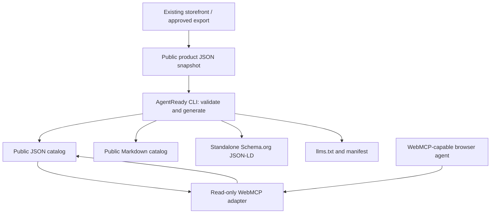

# AgentReady B2A architecture

> **Scope: v0.2.0 experimental implementation.** This document distinguishes what the repository actually implements from future adapter ideas.

## Goal

AgentReady helps developers expose **truthful, public commerce data** in machine-readable formats and optionally register read-only tools for WebMCP-capable browser agents. It does **not** replace a storefront, discover private databases automatically, or perform purchases.

## Current data flow

## Key components

| Path | Responsibility |
| --- | --- |
| `skills/agentready/SKILL.md` | Instructions for an AI coding agent integrating the toolkit into a website. |
| `bin/agentready.mjs` | CLI entry point: inspect, init, generate and verify. |
| `src/core.mjs` | Validates site configuration and published products; emits public resources and verifies local consistency. |
| `src/webmcp-products.js` | Registers public, read-only search and product lookup tools, only if the browser exposes WebMCP. |
| `src/webmcpify-runtime.js` | Adapted WebMCPify runtime, including original MIT notice. |
| `src/integrations/agentmarkup-next.mjs` | Optional integration helper for `@agentmarkup/next`; coordinates which generator owns `llms.txt`. |
| `examples/ecommerce-demo/` | Fictional demo store and smoke-eval fixture. |
| `tests/` | Local validation, regression and simulated WebMCP tests. |

## Trust boundaries

The generator consumes a **build-time public JSON snapshot**, not live stock or real-time price data. It filters to explicitly published records and validates public fields. Generated output must be reviewed before deployment.

The WebMCP adapter uses the generated public snapshot only. It does not read authenticated carts, user records, orders or payment APIs. The browser must provide a compatible WebMCP API for registration to occur.

Schema.org JSON-LD is generated as a **standalone artifact**; it must be integrated into rendered website pages separately. The optional AgentMarkup Next.js config helper is not evidence that an actual Next.js storefront build has passed.

## Upstream reuse

- **AgentMarkup:** optional public package API; no upstream code bundled.
- **WebMCPify:** MIT-licensed runtime adapted and bundled, with attribution preserved.
- **Google Chrome Labs WebMCP Tools:** evaluation fixture format referenced; no source bundled.

Review [THIRD_PARTY_NOTICES.md](THIRD_PARTY_NOTICES.md) and [LICENSE](LICENSE).

## Not yet implemented or verified

- Generalized adapters for commerce platforms or live databases.
- Verified dynamic SSR storefront integration with AgentMarkup.
- Real browser-based WebMCP evaluations and external AI agent discovery.
- Real-time price/availability APIs, checkout or payments.

These are roadmap possibilities, **not** advertised platform support.
