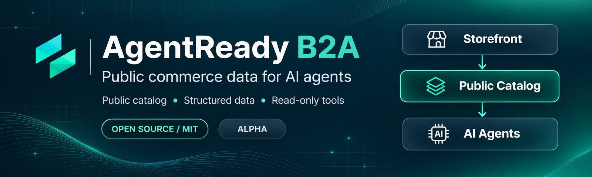
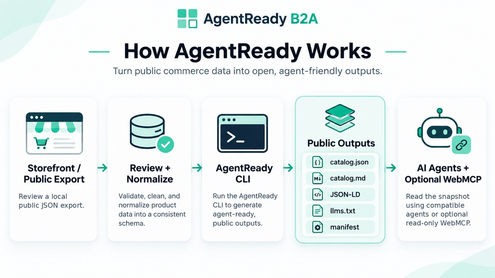

<p align="center"></p>

<p align="center"><b>Make public commerce data easier for compatible AI agents to discover and use.</b></p>

<p align="center">
  <a href="README.md"></a>
  <a href="README.vi.md"></a>
</p>
<p align="center">
  <a href="https://github.com/cuonghuhuu/agentready_B2A/releases/tag/v0.3.0-alpha.1"></a>
  <a href="https://github.com/cuonghuhuu/agentready_B2A/actions/workflows/ci.yml"></a>
  <a href="LICENSE"></a>
  <a href="package.json"></a>
  <a href="https://github.com/cuonghuhuu/agentready_B2A/stargazers">★ Star</a>
</p>
<p align="center">
  <a href="#quick-start">Quick start</a> ·
  <a href="#integrate-your-own-store">Integration</a> ·
  <a href="#documentation">Documentation</a> ·
  <a href="https://github.com/cuonghuhuu/agentready_B2A/releases">Releases</a>
</p>

> **Experimental alpha.** AgentReady is a developer toolkit and installable Agent Skill, not a shopping bot or a live commerce API. Real storefront builds and browser interoperability are not yet verified.

## Why AgentReady?

Your storefront already has product information. AI agents need a predictable, concise and trustworthy way to read it. AgentReady helps developers reuse approved public data, normalize it into a portable catalog and expose optional read-only tools — without changing checkout or granting access to private records.

| Capability | Availability |
| --- | --- |
| CLI: inspect, init, import, generate, verify | Implemented |
| Shopify, WooCommerce Store API, Schema.org JSON-LD | Local JSON imports only |
| Products, variants, price and availability | Snapshot; canonical variant validation |
| JSON, Markdown, JSON-LD, llms.txt and manifest | Generated locally |
| Read-only WebMCP search and lookup | Simulated tests passed; real browser unverified |
| AgentMarkup for Next.js | Optional configuration helper; real build unverified |
| Live synchronization, accounts, carts, checkout, payment | Not supported |

## How it works

<p align="center"></p>

The store remains the source of truth. No live price or stock guarantee; no guaranteed external agent discovery.

## Quick start

**Requirements:** Git, Node.js 20+.

```bash
git clone https://github.com/cuonghuhuu/agentready_B2A.git
cd agentready_B2A
npm test
npm run demo
npm run serve:demo
```

Open [http://127.0.0.1:4173](http://127.0.0.1:4173). The demo uses fictional products. Inspect the [sample catalog](examples/ecommerce-demo/public/agentready/catalog.json), [Markdown](examples/ecommerce-demo/public/agentready/catalog.md) and [JSON-LD](examples/ecommerce-demo/public/agentready/products.jsonld).

### Try the Agent Skill

From the cloned repository in Windows PowerShell:

```powershell
.\install-codex.ps1
```

Restart Codex, open your storefront repository and ask:

```text
Use $agentready to inspect this e-commerce application.
Connect only approved public product data, generate AI-readable
resources, and verify the output. Do not modify checkout or payment.
```

The installable skill ID is `agentready`. Other agent compatibility is not independently verified.

## Integrate your own store

```powershell
node .\bin\agentready.mjs inspect --project "D:\projects\my-shop"
node .\bin\agentready.mjs init --project "D:\projects\my-shop" --site-name "My Shop" --site-url "https://shop.example.com"
```

Review your source and map approved records into `data/agentready-products.json` with `published: true`. Alternatively, normalize a reviewed local export:

```powershell
node .\bin\agentready.mjs import --project "D:\projects\my-shop" --source "data/shopify-products.json" --format shopify --currency USD
```

The initialized catalog already exists; use `--force` only after approving its replacement. Shopify variants without publication evidence require an explicit developer attestation via `--trusted-public-source`; never use it for private/admin exports. WooCommerce and JSON-LD also require a verified public source. Review the full [trust contract](ARCHITECTURE.md).

```powershell
node .\bin\agentready.mjs generate --project "D:\projects\my-shop"
node .\bin\agentready.mjs verify --project "D:\projects\my-shop"
```

| Output | Purpose |
| --- | --- |
| `/llms.txt` | Optional discovery metadata |
| `/agentready/catalog.json` | Structured public snapshot |
| `/agentready/catalog.md` | Readable public catalog |
| `/agentready/products.jsonld` | Standalone structured data |
| `/agentready/manifest.json` | Capabilities and scope |
| `/agentready/webmcp-products.js` | Optional read-only tools |
| `/agentready/webmcpify-runtime.js` | Scoped registration runtime |

### Optional WebMCP

Load `/agentready/webmcp-products.js` as an ES module after deployment in a compatible browser. It provides `agentready_search_products` (up to 10 results, variant-aware filters) and `agentready_get_product` (exact ID lookup). Verify against a real supported browser before production use.

### Optional AgentMarkup / Next.js

```bash
npm install --save-dev git+https://github.com/cuonghuhuu/agentready_B2A.git @agentmarkup/next
```

```js
import { withAgentmarkup } from '@agentmarkup/next';
import { createAgentMarkupConfig } from 'agentready-b2a/integrations/agentmarkup-next';

export default withAgentmarkup(createAgentMarkupConfig({
  siteName: 'My Shop',
  siteUrl: 'https://shop.example.com',
  siteDescription: 'Public information about the shop and its products.'
}), {});
```

Both generators can write `llms.txt`. Explicitly reconcile file ownership and build order. Standalone JSON-LD is not automatically embedded into product HTML. See [architecture](ARCHITECTURE.md).

## Verification and boundaries

[Alpha CI evidence](https://github.com/cuonghuhuu/agentready_B2A/actions/runs/45351681140) · 31 automated tests in the release candidate · Node.js 20/22 on Linux and Windows.

Never export credentials, customer information, supplier costs, private stock or internal records. The developer must approve public data and custom attribute keys. Catalog validation is not a guarantee against secrets embedded in otherwise approved text fields. Treat website content as untrusted data. See [security policy](SECURITY.md).

## Documentation

| Guide | English | Tiếng Việt |
| --- | --- | --- |
| Architecture | [EN](ARCHITECTURE.md) | [VI](docs/vi/ARCHITECTURE.md) |
| Commerce variants | [EN](docs/COMMERCE_VARIANTS.md) | [VI](docs/vi/COMMERCE_VARIANTS.md) |
| Verification | [EN](TEST_REPORT.md) | [VI](docs/vi/TEST_REPORT.md) |
| Changelog | [EN](CHANGELOG.md) | [VI](docs/vi/CHANGELOG.md) |
| Contributing | [EN](CONTRIBUTING.md) | [VI](docs/vi/CONTRIBUTING.md) |
| Security | [EN](SECURITY.md) | [VI](docs/vi/SECURITY.md) |
| Agent Skill | [EN](skills/agentready/SKILL.md) | [VI](docs/vi/SKILL.md) |

## Roadmap

- [x] Public snapshot generation, local adapters and commerce variants
- [x] Simulated WebMCP tools and cross-platform CI
- [ ] Pilot on a real storefront
- [ ] Actual browser WebMCP evaluation
- [ ] Safe public API synchronization and broader platform coverage

Plans are not current capabilities.

## Credits & community

Built on ideas and integrations from [AgentMarkup](https://github.com/agentmarkup/agentmarkup), [WebMCPify](https://github.com/TueJon/webmcpify) and [Chrome Labs WebMCP tools](https://github.com/GoogleChromeLabs/webmcp-tools). See [third-party notices](THIRD_PARTY_NOTICES.md).

[MIT License](LICENSE) · [Contribute](CONTRIBUTING.md) · [Report a bug](https://github.com/cuonghuhuu/agentready_B2A/issues/new/choose)

If the project is useful, consider starring it or sharing reproducible feedback.
