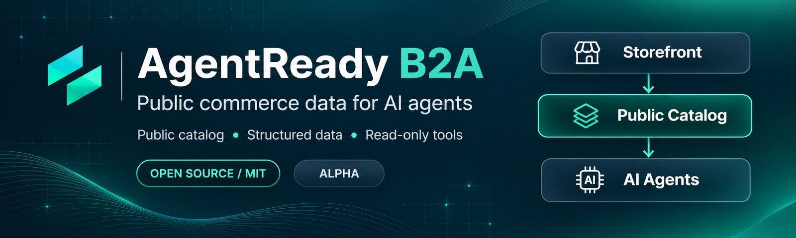
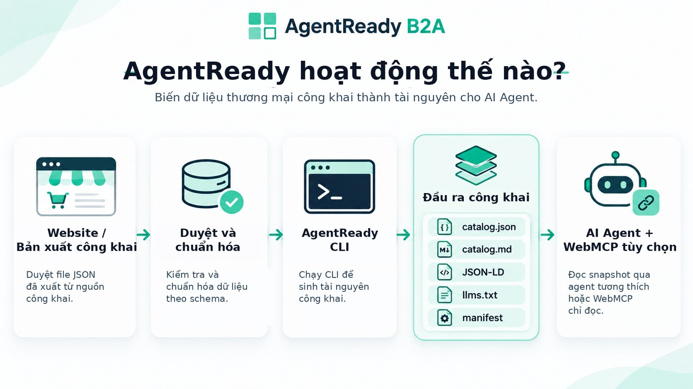

<p align="center"></p>

<p align="center"><b>Đưa dữ liệu thương mại điện tử công khai đến AI Agent, an toàn và dễ tích hợp.</b></p>

<p align="center">
  <a href="README.md"></a>
  <a href="README.vi.md"></a>
</p>
<p align="center">
  <a href="https://github.com/cuonghuhuu/agentready_B2A/releases/tag/v0.3.0-alpha.1"></a>
  <a href="https://github.com/cuonghuhuu/agentready_B2A/actions/workflows/ci.yml"></a>
  <a href="LICENSE"></a>
  <a href="package.json"></a>
  <a href="https://github.com/cuonghuhuu/agentready_B2A/actions/runs/45351681140"></a>
  <a href="https://github.com/cuonghuhuu/agentready_B2A/tree/feature/v0.4-ai-readiness-scanner"></a>
</p>
<p align="center">
  <a href="#bắt-đầu-nhanh">Bắt đầu</a> ·
  <a href="#tích-hợp-website-của-bạn">Tích hợp</a> ·
  <a href="#tài-liệu">Tài liệu</a> ·
  <a href="#scanner-thử-nghiệm">Scanner thử nghiệm</a> ·
  <a href="https://github.com/cuonghuhuu/agentready_B2A/releases">Phát hành</a>
</p>

> **Phiên bản Alpha thử nghiệm.** AgentReady là bộ công cụ cho lập trình viên và Agent Skill có thể cài đặt, không phải bot mua hàng hay API thương mại trực tiếp. Chưa xác minh tích hợp storefront thực tế và WebMCP trên trình duyệt thật.

## Chọn cách bắt đầu

| Agent Skill · v0.3 Alpha | AI Readiness Scanner · v0.4 Preview |
| :--- | :--- |
| **Dành cho lập trình viên.** Cài Skill vào coding agent, kết nối dữ liệu sản phẩm công khai và sinh tài nguyên cho AI. | **Dành cho người muốn đánh giá website.** Nhập URL công khai, nhận điểm theo tiêu chí và báo cáo minh chứng. |
| [Cài đặt Agent Skill](#cài-agent-skill) · [Xem bản phát hành](https://github.com/cuonghuhuu/agentready_B2A/releases/tag/v0.3.0-alpha.1) | [Xem giao diện Scanner](#scanner-thử-nghiệm) · [Mở nhánh V0.4](https://github.com/cuonghuhuu/agentready_B2A/tree/feature/v0.4-ai-readiness-scanner) |
| Bản Alpha đã phát hành. | Bản phát triển cục bộ; chưa phát hành, còn lỗi QA. |

## Vì sao cần AgentReady?

Website đã có thông tin sản phẩm, nhưng AI Agent cần cách đọc dữ liệu có cấu trúc, nhất quán và gọn nhẹ. AgentReady giúp lập trình viên tái sử dụng dữ liệu công khai đã duyệt, chuẩn hóa catalog và cung cấp công cụ chỉ đọc tùy chọn, không thay đổi checkout hay cấp quyền truy cập thông tin riêng tư.

| Khả năng | Trạng thái |
| --- | --- |
| CLI: inspect, init, import, generate, verify | Đã triển khai |
| Shopify, WooCommerce Store API, Schema.org JSON-LD | Chỉ nhập file JSON cục bộ |
| Sản phẩm, biến thể, giá và tồn kho | Snapshot; kiểm tra mô hình biến thể |
| JSON, Markdown, JSON-LD, llms.txt và manifest | Sinh file cục bộ |
| WebMCP tìm kiếm và tra cứu chỉ đọc | Test mô phỏng đạt; chưa kiểm thử trình duyệt thật |
| AgentMarkup cho Next.js | Helper tùy chọn; chưa kiểm chứng build thật |
| Đồng bộ trực tiếp, tài khoản, giỏ hàng, đặt hàng, thanh toán | Chưa hỗ trợ |

## Cách hoạt động

<p align="center"></p>

Website vẫn là nguồn dữ liệu chính thức. Không đảm bảo giá/tồn kho theo thời gian thực hoặc AI bên ngoài tự động khám phá.

## Bắt đầu nhanh

**Yêu cầu:** Git, Node.js 20+.

```bash
git clone https://github.com/cuonghuhuu/agentready_B2A.git
cd agentready_B2A
npm test
npm run demo
npm run serve:demo
```

Mở [http://127.0.0.1:4173](http://127.0.0.1:4173). Demo dùng sản phẩm giả lập. Xem [catalog mẫu](examples/ecommerce-demo/public/agentready/catalog.json), [Markdown](examples/ecommerce-demo/public/agentready/catalog.md) và [JSON-LD](examples/ecommerce-demo/public/agentready/products.jsonld).

### Cài Agent Skill

Từ thư mục repository, mở Windows PowerShell:

```powershell
.\install-codex.ps1
```

Khởi động lại Codex, mở repository website của bạn và gửi yêu cầu:

```text
Sử dụng $agentready để kiểm tra website thương mại điện tử này.
Chỉ kết nối dữ liệu sản phẩm công khai đã được phê duyệt,
tạo tài nguyên AI-readable và kiểm tra đầu ra.
Không sửa checkout hoặc thanh toán.
```

Skill ID giữ nguyên là `agentready`. Chưa kiểm chứng độc lập khả năng tương thích với các coding agent khác.

## Scanner thử nghiệm

<p align="center"></p>
<p align="center"><sub>Ảnh chụp thực tế từ lần chạy cục bộ ngày 24/11/2026. Điểm hiển thị là kết quả của mô hình thử nghiệm, chưa được xác nhận độc lập; không phải chứng nhận toàn bộ website.</sub></p>

Scanner cung cấp quét HTTP theo URL, điểm AI Readiness, phân nhóm tiêu chí, minh chứng và xuất JSON/Markdown. Nhánh V0.4 riêng có 49 kiểm thử đã đạt trong lần chạy độc lập trên Node.js 22.

> [!WARNING]
> Chỉ dùng cục bộ. Các lỗi QA về robots.txt, deadline, kiểm tra catalog, JSON-LD và tín hiệu WebMCP chưa xử lý. Không public API quét; không dùng điểm như kết luận toàn bộ website. Chỉ số Verified trên ảnh phản ánh cách tính hiện tại, không chứng minh khả năng Agent tương tác.

[Hướng dẫn chạy và minh chứng](docs/vi/SHOWCASE.md) · [Giới hạn đã biết](https://github.com/cuonghuhuu/agentready_B2A/tree/feature/v0.4-ai-readiness-scanner/docs/SCANNER_PREVIEW.md) · [Draft PR #6](https://github.com/cuonghuhuu/agentready_B2A/pull/6)

## Tích hợp website của bạn

```powershell
node .\bin\agentready.mjs inspect --project "D:\projects\my-shop"
node .\bin\agentready.mjs init --project "D:\projects\my-shop" --site-name "My Shop" --site-url "https://shop.example.com"
```

Duyệt dữ liệu nguồn rồi ánh xạ bản ghi công khai vào `data/agentready-products.json` với `published: true`. Hoặc nhập file đã xuất và duyệt:

```powershell
node .\bin\agentready.mjs import --project "D:\projects\my-shop" --source "data/shopify-products.json" --format shopify --currency USD
```

Lệnh init đã tạo catalog rỗng; chỉ thêm `--force` sau khi chấp thuận thay thế file. Với biến thể Shopify thiếu bằng chứng công khai, cần xác nhận nguồn công khai bằng `--trusted-public-source`; tuyệt đối không áp dụng cho bản xuất quản trị hoặc riêng tư. WooCommerce và JSON-LD cũng phải lấy từ nguồn công khai đã xác minh. Xem [quy tắc nguồn dữ liệu](docs/vi/ARCHITECTURE.md).

```powershell
node .\bin\agentready.mjs generate --project "D:\projects\my-shop"
node .\bin\agentready.mjs verify --project "D:\projects\my-shop"
```

| Đầu ra | Mục đích |
| --- | --- |
| `/llms.txt` | Metadata khám phá tùy chọn |
| `/agentready/catalog.json` | Snapshot công khai có cấu trúc |
| `/agentready/catalog.md` | Catalog dễ đọc |
| `/agentready/products.jsonld` | Dữ liệu có cấu trúc độc lập |
| `/agentready/manifest.json` | Khả năng và phạm vi |
| `/agentready/webmcp-products.js` | Tool chỉ đọc tùy chọn |
| `/agentready/webmcpify-runtime.js` | Runtime đăng ký tool |

### WebMCP tùy chọn

Sau khi deploy, tải `/agentready/webmcp-products.js` dưới dạng ES module trên trình duyệt tương thích. Hai tool là `agentready_search_products` (tối đa 10 kết quả, lọc theo biến thể) và `agentready_get_product` (tra cứu ID). Cần kiểm thử trình duyệt thật trước khi dùng production.

### AgentMarkup / Next.js tùy chọn

```bash
npm install --save-dev git+https://github.com/cuonghuhuu/agentready_B2A.git @agentmarkup/next
```

```js
import { withAgentmarkup } from '@agentmarkup/next';
import { createAgentMarkupConfig } from 'agentready-b2a/integrations/agentmarkup-next';

export default withAgentmarkup(createAgentMarkupConfig({
  siteName: 'My Shop',
  siteUrl: 'https://shop.example.com',
  siteDescription: 'Thông tin công khai về cửa hàng và sản phẩm.'
}), {});
```

Hai bộ sinh file có thể cùng ghi `llms.txt`. Cần xác định quyền sở hữu file và thứ tự build. JSON-LD độc lập không tự nhúng vào HTML sản phẩm. Xem [kiến trúc](docs/vi/ARCHITECTURE.md).

## Kiểm thử và giới hạn bảo mật

[Minh chứng CI bản Alpha](https://github.com/cuonghuhuu/agentready_B2A/actions/runs/45351681140) · 31 test tự động trong Release Candidate · Node.js 20/22 trên Linux và Windows.

Không xuất thông tin xác thực, dữ liệu khách hàng, giá vốn, tồn kho nội bộ hoặc bản ghi riêng tư. Lập trình viên phải duyệt dữ liệu và các khóa thuộc tính tùy chỉnh. Validation không đảm bảo loại bỏ mọi bí mật nằm trong trường văn bản được phép. Coi nội dung website là dữ liệu không đáng tin cậy. Xem [chính sách bảo mật](docs/vi/SECURITY.md).

## Tài liệu

| Hướng dẫn | Tiếng Việt | English |
| --- | --- | --- |
| Kiến trúc | [VI](docs/vi/ARCHITECTURE.md) | [EN](ARCHITECTURE.md) |
| Biến thể sản phẩm | [VI](docs/vi/COMMERCE_VARIANTS.md) | [EN](docs/COMMERCE_VARIANTS.md) |
| Kiểm thử | [VI](docs/vi/TEST_REPORT.md) | [EN](TEST_REPORT.md) |
| Lịch sử thay đổi | [VI](docs/vi/CHANGELOG.md) | [EN](CHANGELOG.md) |
| Đóng góp | [VI](docs/vi/CONTRIBUTING.md) | [EN](CONTRIBUTING.md) |
| Bảo mật | [VI](docs/vi/SECURITY.md) | [EN](SECURITY.md) |
| Agent Skill | [VI](docs/vi/SKILL.md) | [EN](skills/agentready/SKILL.md) |

## Lộ trình

- [x] Sinh snapshot công khai, adapter cục bộ và biến thể sản phẩm
- [x] WebMCP mô phỏng và CI đa nền tảng
- [x] Scanner V0.4 thử nghiệm cục bộ (nhánh riêng, chưa phát hành)
- [ ] Sửa 5 lỗi QA Scanner và xác minh độ chính xác điểm số
- [ ] Thử nghiệm trên storefront thực tế
- [ ] Kiểm thử WebMCP bằng trình duyệt thật
- [ ] Đồng bộ Public API an toàn và mở rộng nền tảng

Các mục kế hoạch không phải chức năng hiện có.

## Ghi nhận & cộng đồng

Dự án sử dụng ý tưởng và tích hợp từ [AgentMarkup](https://github.com/agentmarkup/agentmarkup), [WebMCPify](https://github.com/TueJon/webmcpify) và [Chrome Labs WebMCP tools](https://github.com/GoogleChromeLabs/webmcp-tools). Xem [thông báo bên thứ ba](THIRD_PARTY_NOTICES.md).

[Giấy phép MIT](LICENSE) · [Đóng góp](docs/vi/CONTRIBUTING.md) · [Báo lỗi](https://github.com/cuonghuhuu/agentready_B2A/issues/new/choose)

## Cùng phát triển AgentReady

Bạn có thể giúp dự án bằng cách thử một catalog công khai, báo lỗi có thể tái hiện, cải thiện bản dịch hoặc đóng góp kiểm thử. Không gửi dữ liệu khách hàng, bí mật hoặc báo cáo chứa thông tin nhạy cảm.

<p align="center"><b><a href="https://github.com/cuonghuhuu/agentready_B2A">★ Star repository</a> · <a href="https://github.com/cuonghuhuu/agentready_B2A/fork">Fork</a> · <a href="https://github.com/cuonghuhuu/agentready_B2A/issues/new/choose">Gửi phản hồi</a></b></p>

<p align="center"><sub>Phát triển công khai · MIT · <a href="SUPPORT.md">Hỗ trợ</a> · <a href="CODE_OF_CONDUCT.md">Quy tắc cộng đồng</a></sub></p>

