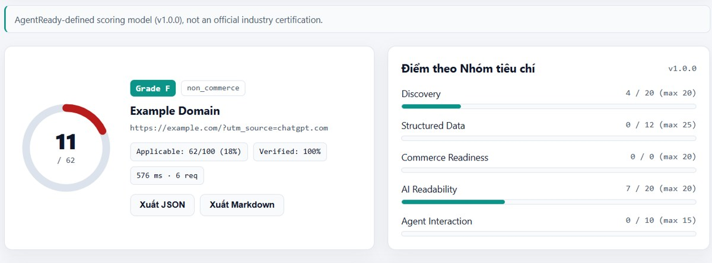

[Home](../README.md) · [Tiếng Việt](vi/SHOWCASE.md)

# Try AgentReady

## Published Alpha — public commerce catalog

Use Node.js 20 or newer and Git.

```bash
git clone --branch v0.3.0-alpha.1 https://github.com/cuonghuhuu/agentready_B2A.git
cd agentready_B2A
npm test
npm run demo
npm run serve:demo
```

Open http://127.0.0.1:4173. Search for woody or citrus, then inspect the public JSON, Markdown, JSON-LD and llms.txt endpoints. This is a fictional storefront, not a live commerce service.

## Local scanner preview — V0.4



The screenshot shows example.com inspected locally on 24 Nov 2026. It illustrates the interface, not a validated score. Browser chrome was cropped; the displayed result was not altered.

```bash
git clone --branch feature/v0.4-ai-readiness-scanner https://github.com/cuonghuhuu/agentready_B2A.git agentready-scanner-preview
cd agentready-scanner-preview
npm test
npm run demo
npm run serve:scanner
```

Open http://127.0.0.1:4174. The store demo remains at /demo. Use only public URLs you are permitted to inspect. The preview is unreleased; do not expose it via public hosting, a tunnel or reverse proxy.

See the [known QA blockers](https://github.com/cuonghuhuu/agentready_B2A/blob/feature/v0.4-ai-readiness-scanner/docs/SCANNER_PREVIEW.md) and [draft PR #6](https://github.com/cuonghuhuu/agentready_B2A/pull/6).

## Verification

- [Published alpha CI](https://github.com/cuonghuhuu/agentready_B2A/actions/runs/45351681140): 31 automated tests; Windows/Linux and Node 20/22.
- [Scanner integration CI](https://github.com/cuonghuhuu/agentready_B2A/actions/runs/45364811371): separate V0.4 preview.
- Real browser WebMCP, live storefront integration and validated readiness scores remain unverified.

Never treat the experimental score as certification, or compare websites with different applicable criteria as if their scores were directly comparable.
