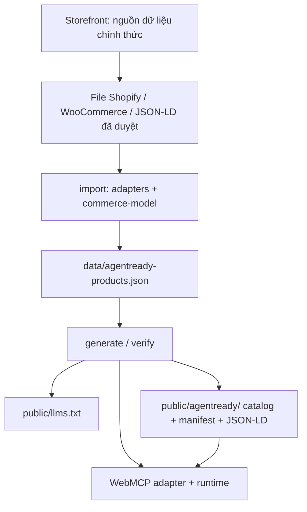

[← Trang chủ tiếng Việt](../../README.vi.md) · [English](../../ARCHITECTURE.md)

# Kiến trúc — AgentReady B2A v0.3 Alpha

## Phạm vi

Bộ công cụ phát triển (Agent Skill và CLI Node.js) giúp kiểm tra cửa hàng, chuẩn hóa bản xuất công khai cục bộ, sinh tài nguyên máy đọc được và kiểm tra tính nhất quán. Tích hợp runtime tùy chọn cung cấp công cụ WebMCP chỉ đọc trên trình duyệt hỗ trợ.

Snapshot không tự cập nhật khi giá, sản phẩm hoặc tồn kho thay đổi.

| Module | Trách nhiệm |
| --- | --- |
| `skills/agentready/SKILL.md` | Quy trình và quy tắc an toàn cho coding agent |
| `bin/agentready.mjs` | CLI inspect/init/import/generate/verify |
| `src/adapters.mjs` | Import ba định dạng cục bộ; kiểm tra nguồn và thuộc tính |
| `src/commerce-model.mjs` | Chuẩn hóa biến thể công khai |
| `src/core.mjs` | Kiểm tra dữ liệu, sinh file, xác minh đầu ra |
| `src/webmcp-products.js` | Tìm kiếm và tra cứu snapshot chỉ đọc |
| `src/webmcpify-runtime.js` | Runtime WebMCPify đã giữ thông báo MIT |
| `src/integrations/agentmarkup-next.mjs` | Helper cấu hình Next.js tùy chọn |
| `examples/`, `tests/` | Fixture giả lập và test Node.js |

## Quy tắc nguồn công khai

- Shopify: sản phẩm cha phải có `published_at` hợp lệ không ở tương lai hoặc `published:true`, trạng thái active hoặc không có status. Biến thể cần bằng chứng riêng; chỉ dùng `--trusted-public-source` cho bản xuất storefront công khai đã được xác minh. Không suy diễn từ `available`.
- WooCommerce Store API: dùng bản xuất công khai đã duyệt, loại bản ghi đánh dấu riêng tư/ẩn, yêu cầu trạng thái tồn kho rõ ràng và `currency_minor_unit` nguyên từ 0 đến 6.
- JSON-LD: chỉ lấy từ trang công khai; loại sản phẩm, offer và container cha được đánh dấu riêng tư hoặc chưa xuất bản. Không suy diễn tồn kho khi thiếu thông tin.
- Thuộc tính: chỉ dùng `DEFAULT_ALLOWED_ATTRIBUTES` hoặc danh sách được duyệt qua `--allow-attributes`. Người tích hợp phải rà soát cả nội dung văn bản.
- Hệ thống file: chặn đường dẫn thoát khỏi project, symlink đầu ra, trùng nguồn/đích; chỉ dùng `--force` khi duyệt file cần thay.
- WebMCP: tìm kiếm theo từng biến thể, áp dụng ngân sách, tiền tệ và tồn kho cùng offer; giá đại diện đi cùng tồn kho, khoảng giá tách riêng. Khi có nhiều tiền tệ phải chỉ rõ currency nếu lọc giá.
- JSON-LD độc lập chưa tự nhúng HTML sản phẩm. AgentMarkup là helper cấu hình, cần xử lý xung đột `llms.txt`.

## Mức độ xác minh

Sinh file và kiểm tra snapshot, test mô phỏng WebMCP và CI đã chạy. Build Next.js thật, WebMCP Evals trên trình duyệt thật, khám phá bởi agent bên ngoài và dữ liệu live chưa xác minh. Không hỗ trợ giao dịch hoặc đồng bộ cơ sở dữ liệu. Xem [báo cáo kiểm thử](TEST_REPORT.md).
