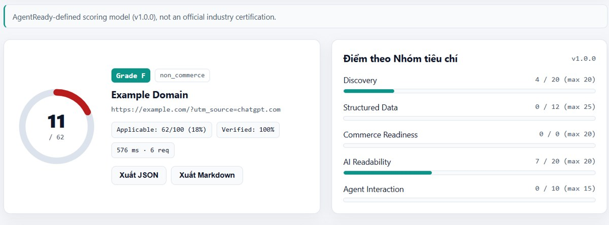

[Trang chủ](../../README.vi.md) · [English](../SHOWCASE.md)

# Trải nghiệm AgentReady

## Bản Alpha — catalog sản phẩm công khai

Yêu cầu Git và Node.js 20 trở lên.

```bash
git clone --branch v0.3.0-alpha.1 https://github.com/cuonghuhuu/agentready_B2A.git
cd agentready_B2A
npm test
npm run demo
npm run serve:demo
```

Mở http://127.0.0.1:4173. Tìm woody hoặc citrus, rồi xem dữ liệu JSON, Markdown, JSON-LD và llms.txt công khai. Demo sử dụng sản phẩm giả lập, không giao dịch thật.

## Scanner V0.4 — bản phát triển



Ảnh chụp kết quả example.com ngày 24/11/2026. Minh họa giao diện, không phải điểm số đã được kiểm định. Chỉ cắt bỏ thanh trình duyệt, không sửa kết quả hiển thị.

```bash
git clone --branch feature/v0.4-ai-readiness-scanner https://github.com/cuonghuhuu/agentready_B2A.git agentready-scanner-preview
cd agentready-scanner-preview
npm test
npm run demo
npm run serve:scanner
```

Mở http://127.0.0.1:4174. Demo cửa hàng ở /demo. Chỉ quét URL công khai mà bạn được phép kiểm tra. Chưa phát hành; không triển khai public, không mở tunnel hoặc reverse proxy.

[Giới hạn và lỗi QA](https://github.com/cuonghuhuu/agentready_B2A/blob/feature/v0.4-ai-readiness-scanner/docs/vi/SCANNER_PREVIEW.md) · [Draft PR #6](https://github.com/cuonghuhuu/agentready_B2A/pull/6)

## Minh chứng

- [CI Alpha](https://github.com/cuonghuhuu/agentready_B2A/actions/runs/45351681140): 31 test, Windows/Linux và Node 20/22.
- [CI nhánh Scanner](https://github.com/cuonghuhuu/agentready_B2A/actions/runs/45364811371): nhánh V0.4 riêng.
- Chưa kiểm chứng WebMCP trình duyệt thật, tích hợp storefront thật hoặc độ chính xác điểm Scanner.

Không dùng điểm thử nghiệm như chứng nhận; không so sánh trực tiếp website có phạm vi tiêu chí khác nhau.
